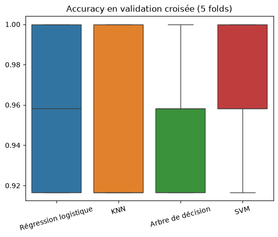
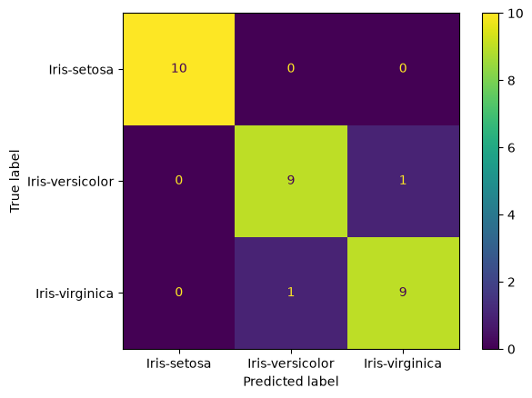

# 🌸 Classification des fleurs d'iris

> Premier projet de Machine Learning : prédire l'espèce d'une fleur d'iris à partir de 4 mesures. Le modèle retenu (SVM) atteint **93,3 % d'accuracy** sur des données jamais vues.

## Objectif
Prédire l'espèce d'une fleur d'iris (setosa, versicolor ou virginica) à partir des dimensions de ses sépales et de ses pétales.
Il s'agit d'un problème de **classification supervisée multiclasse**.

## Données
- Source : dataset Iris (UCI / Kaggle)
- 150 fleurs, 3 espèces (50 par espèce)
- 4 variables en cm : `SepalLengthCm`, `SepalWidthCm`, `PetalLengthCm`, `PetalWidthCm`

## Démarche
- **Nettoyage** : aucune valeur manquante, suppression de la colonne `Id`, 3 doublons conservés
- **Analyse exploratoire** : boxplots, pairplot et corrélations. Les pétales sont les variables les plus discriminantes.
- **Préparation** : split train/test 80/20 stratifié
- **Comparaison de 4 modèles** en validation croisée (5 folds) sur le train uniquement
- **Réglage des hyperparamètres** du meilleur modèle avec `GridSearchCV`
- **Évaluation finale** sur le jeu de test

## Résultats

| Modèle | Accuracy (validation croisée) |
|---|---|
| **SVM** | **96,7 %** |
| Régression logistique | 95,8 % |
| KNN | 95,0 % |
| Arbre de décision | 95,0 % |

Après réglage (noyau linéaire, C = 0,1), le SVM obtient **93,3 % sur le jeu de test** (28 fleurs sur 30).





Iris-setosa est parfaitement reconnue. Les 2 erreurs concernent versicolor et virginica, deux espèces dont les mesures se chevauchent, comme l'avait montré l'analyse exploratoire.

## Ce que j'ai appris
- Séparer train et test, et ne jamais utiliser le test avant l'évaluation finale
- Comparer des modèles de façon fiable avec la validation croisée
- Intégrer la mise à l'échelle dans un pipeline pour éviter les fuites de données
- Régler des hyperparamètres avec `GridSearchCV`
- Lire une matrice de confusion et un rapport de classification

## Lancer le projet
```bash
git clone https://github.com/yassinehq/Iris-ml.git
cd Iris-ml
python -m venv .venv
.venv\Scripts\activate
pip install -r requirements.txt
jupyter notebook notebooks/01_iris_classification.ipynb
```

## Stack
Python · pandas · matplotlib · seaborn · scikit-learn · Jupyter